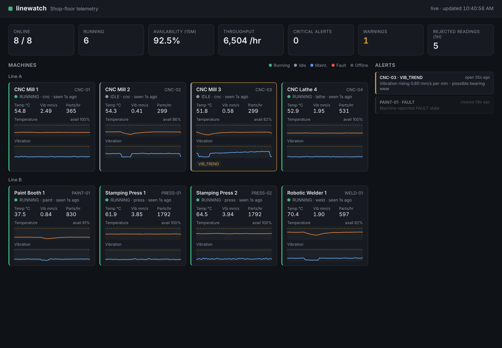

# linewatch


Industrial IoT telemetry dashboard. A fleet of shop-floor machines streams
temperature, vibration, RPM and part counts to an authenticated ingest API;
linewatch validates every reading, stores it in SQLite, raises and clears
alerts in real time, and shows fleet health on a live dashboard. Deploys to
AWS with one CloudFormation command.

**Deployed and verified on AWS EC2 (us-east-2) on Nov 12, 2026**: passed the health check and served the dashboard publicly, then torn down to avoid cost. Redeploy anytime with the one command under "Deploy to AWS".



## What it does

- **Ingest API**: `POST /api/ingest` takes one reading or a batch of up to 500.
  It requires an API key, compared in constant time (`hmac.compare_digest`).
  The app refuses to start if the key is missing or under 16 characters.
- **Data validation**: devices are treated as untrusted input. Each reading gets:
  - type and range checks against physically plausible limits
  - rejection of NaN/inf values and of booleans posing as numbers
  - timestamp checks for clock skew and stale data
  - idempotent ingest: a re-sent reading (same machine and timestamp) is stored once and never re-alerts
  - a strict machine-ID format

  Bad readings are written to a dead-letter table with the reason. They are
  never dropped silently, and the dashboard shows the rejected count.
- **Alert engine**: there are four rules:

  | Rule | Fires when |
  |---|---|
  | `OVERTEMP` | temperature at or above 85 °C (warning) or 95 °C (critical) |
  | `VIBRATION` | vibration at or above 7.1 / 11.2 mm/s, zones modeled on ISO 10816 |
  | `VIB_TREND` | vibration keeps rising (least-squares slope ≥ 0.6 mm/s per minute over the last 2 minutes, at least 30 s of data), an early warning of bearing wear |
  | `FAULT` | the machine reports a fault state |

  Threshold alerts escalate from warning to critical in place and track the
  peak value. They close only after the value drops below 90% of the limit
  (hysteresis), so a reading hovering at the line doesn't flap the alert open
  and closed.
- **Fleet KPIs**:
  - online/running counts
  - 15-minute availability
  - throughput from cumulative part counters (handles counter resets)
  - open alerts by severity
  - stale-device detection: no data for 30 s marks a machine OFFLINE
- **Dashboard**: plain HTML/JS with no CDN, so a strict Content-Security-Policy
  (`default-src 'self'`) works. All device-supplied text is rendered with
  `textContent`, so a compromised sensor can't inject script into the
  operator's browser.
- **Simulator**: eight machines on two lines, with scripted failures:
  - bearing wear on CNC-03
  - an overheat cycle on PRESS-02
  - random faults, idle periods and PLC counter resets
  - about 1% deliberately malformed readings

## Run it locally

```sh
pip install -r requirements.txt
export LINEWATCH_API_KEY=$(openssl rand -hex 24)
python -m linewatch.app &                   # http://127.0.0.1:8000
python -m linewatch.simulator               # same shell, so it shares the key
```

Watch CNC-03: `VIB_TREND` fires first while vibration is still in the normal
range, then `VIBRATION` warning, then critical, then the machine goes into
maintenance and everything clears.

## Tests

```sh
pip install -r requirements-dev.txt && pytest -q     # 28 tests
```

The tests cover validation edge cases, auth, partial-batch rejection, duplicate readings,
alert open/escalate/hysteresis/close, the trend alert firing before the
threshold alert, counter-reset math, offline detection and retention.
CI runs them on Python 3.9 (Amazon Linux 2023's system Python) and 3.12, and
lints the CloudFormation template and the setup script.

## Deploy to AWS

```sh
aws cloudformation deploy \
  --stack-name linewatch \
  --template-file deploy/cloudformation.yaml \
  --capabilities CAPABILITY_IAM \
  --parameter-overrides AllowedCidr=0.0.0.0/0
aws cloudformation describe-stacks --stack-name linewatch \
  --query "Stacks[0].Outputs" --output table
```

The stack runs one small EC2 instance (t3.micro, free-tier eligible on most
accounts) running Amazon Linux 2023 in the region's default VPC. It only
reports CREATE_COMPLETE after the app passes a health check on the instance
(`cfn-signal`); if first boot fails, the stack rolls back. nginx sits in
front of gunicorn, and the app and simulator run as sandboxed systemd services.

| Hardening | Why |
|---|---|
| Security group allows port 80 only. **No SSH port**; admin access is through SSM Session Manager | nothing to brute-force |
| nginx returns 403 on `/api/ingest` from outside; only on-box devices can write | public users get read-only access |
| IMDSv2 required, hop limit 1 | blocks SSRF-style theft of instance credentials |
| Encrypted gp3 root volume | data at rest |
| IAM role holds only `AmazonSSMManagedInstanceCore` | least privilege |
| API key generated on the instance with `openssl rand`, file mode 600, never in user data or the template | the secret never leaves the box |
| systemd sandboxing: `ProtectSystem=strict`, `NoNewPrivileges`, write access to `/var/lib/linewatch` only | limits damage if the app is compromised |
| nginx per-IP rate limiting, `server_tokens off`; app sets CSP, `nosniff` and `X-Frame-Options` | basic web hardening |

Tear down with `aws cloudformation delete-stack --stack-name linewatch`.

## Layout

```
linewatch/app.py         Flask app: ingest, read API, security headers
linewatch/validation.py  input validation for untrusted device data
linewatch/rules.py       alert rules, hysteresis, trend detection
linewatch/queries.py     KPIs and dashboard queries
linewatch/db.py          SQLite schema (WAL), retention
linewatch/simulator.py   shop-floor simulator
static/                  dashboard (no external dependencies)
deploy/                  CloudFormation, setup script, systemd units, nginx
```

Neel Patel, 2026
